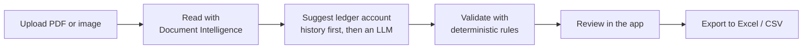
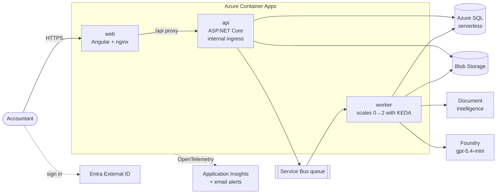

# Plumy

[](https://github.com/chelomama-dev/plumy/actions/workflows/ci.yml)

AI-powered supplier invoice processing for Spanish accounting firms (*gestorías*). Upload the invoices of your
clients, and Plumy reads them, suggests the ledger account, flags the ones that need a human look and exports
them ready to import into the accounting software.

Built end to end as a portfolio project with **.NET 10, Angular 22, Azure SQL and Azure Container Apps**,
deployed with Bicep and GitHub Actions.

## What it does



- **Multi-tenant**: each accounting firm is a tenant with its own people (invitations by verified email) and its
  own client companies (NIF/NIE/CIF validated in the domain and in the front).
- **Reading**: uploads go to Blob Storage and a queue; a background worker reads them with Document Intelligence's
  prebuilt invoice model.
- **Ledger account suggestion**: the account last confirmed for the same supplier wins; if there's none,
  `gpt-5.4-mini` in Microsoft Foundry picks one from the Spanish chart of accounts with structured outputs.
  Suggestions are stored apart from confirmations, so their accuracy can be measured.
- **Validation**: tax IDs, base + VAT (− withholding) = total, VAT rates and duplicates. Problems are warnings,
  not errors: the invoice is flagged for review, never rejected.
- **Review**: a person corrects what was read (the checks run again on it), then approves or rejects the invoice.
  The reader's confidence is kept per field, and so is which fields a person changed.
- **Export**: the approved invoices, as Excel or as CSV in the format Spanish Excel opens directly, protected
  against formula injection.

## Architecture



The backend follows a light **Clean Architecture**: `Domain` (entities, value objects, validation rules, no
dependencies), `Application` (use cases with plain handlers, no MediatR), `Infrastructure` (EF Core, Azure SDKs)
and two hosts, `Api` and `Worker`. Locally, **Aspire** starts everything with one command: SQL Server, Azurite,
the Service Bus emulator, the API, the worker and Angular.

## Things worth a look

- **No secrets anywhere.** Every service signs in with a managed identity and has local auth disabled: SQL accepts
  Entra ID only, Storage has shared keys off, and Service Bus, Document Intelligence, Foundry and Application
  Insights reject keys. GitHub deploys to Azure through OIDC federation, so the repo has no secrets either.
- **Infrastructure as code.** Everything in Azure is in [Bicep](infra/), compiled and linted in every PR and
  deployed by the pipeline. Nothing is created by hand in the portal.
- **Pipeline.** Every PR builds and tests backend and frontend; merging to `main` publishes the images to GHCR,
  deploys the Bicep and runs the EF Core migrations. `main` is protected by a [ruleset](.github/rulesets/)
  (required checks, squash only, linear history).
- **Testing.** 600+ backend tests (xUnit; integration and API tests against a real SQL Server with
  Testcontainers) and 170+ frontend tests (Vitest).
- **Least privilege.** People get read-only access to production by default, and each app has its own identity
  with only the data roles it needs (for example, the API can send to the queue but not read it).
- **Cost.** Scale to zero and free tiers (Azure SQL free offer, Container Apps consumption grant): idle, it costs
  close to nothing.

## Tech stack

| Area | Choice |
|---|---|
| Backend | .NET 10, ASP.NET Core minimal APIs, EF Core 10 |
| Frontend | Angular 22 (signals, `httpResource`, Signal Forms), Angular Material, pnpm |
| Data | Azure SQL Database (SQL Server in a container locally) |
| Messaging | Azure Service Bus + KEDA |
| AI | Azure Document Intelligence, Microsoft Foundry (`gpt-5.4-mini`) |
| Auth | Microsoft Entra External ID (MSAL in the SPA, JWT bearer in the API) |
| Hosting | Azure Container Apps |
| IaC / CI/CD | Bicep, GitHub Actions, GHCR, Dependabot |
| Observability | OpenTelemetry, Application Insights, Azure Monitor alerts |
| Local dev | Aspire 13, Docker |

## Decisions

Every non-obvious decision is written down as an Architecture Decision Record:

| ADR | Decision |
|---|---|
| [0001](docs/adr/0001-authentication-with-entra-external-id.md) | Authentication with Microsoft Entra External ID |
| [0002](docs/adr/0002-firm-invitations-without-email-delivery.md) | Firm invitations matched by verified email, without sending emails |
| [0003](docs/adr/0003-invoice-extraction-in-a-background-worker.md) | Read invoices in a background worker fed by a Service Bus queue |
| [0004](docs/adr/0004-read-invoices-with-document-intelligence.md) | Read invoices with Document Intelligence's prebuilt invoice model |
| [0005](docs/adr/0005-suggest-ledger-accounts-with-rules-then-a-language-model.md) | Suggest ledger accounts with rules first, then a language model in Foundry |
| [0006](docs/adr/0006-validate-invoices-with-deterministic-rules.md) | Validate read invoices with deterministic rules, stored as warnings |
| [0007](docs/adr/0007-export-invoices-to-excel-and-csv.md) | Export read invoices to Excel and CSV, read-only |
| [0008](docs/adr/0008-review-invoices-before-booking-them.md) | A person corrects, approves or rejects each invoice before it is booked |

## Repository layout

```
src/
  Plumy.Domain/          entities, value objects, rules
  Plumy.Application/     use cases
  Plumy.Infrastructure/  EF Core, Azure SDK clients
  Plumy.Api/             HTTP API
  Plumy.Worker/          invoice reading worker
  Plumy.AppHost/         Aspire orchestration for local dev
  Plumy.ServiceDefaults/ OpenTelemetry, health checks, resilience
tests/                   one test project per layer + API and worker
web/                     Angular app (+ nginx image)
infra/                   Bicep modules and bootstrap scripts
docs/                    product, tech stack, dev setup, ADRs
```

## Run it locally

Requires the .NET 10 SDK, Docker, Node.js 24 with pnpm, and the Aspire CLI. Then:

```bash
aspire run
```

Details in [Development environment setup](docs/dev-setup.md).

## Status

The MVP is complete and running in Azure: upload → read → classify → validate → export. See the
[product definition](docs/product.md) and the [tech stack & roadmap](docs/tech-stack.md).
